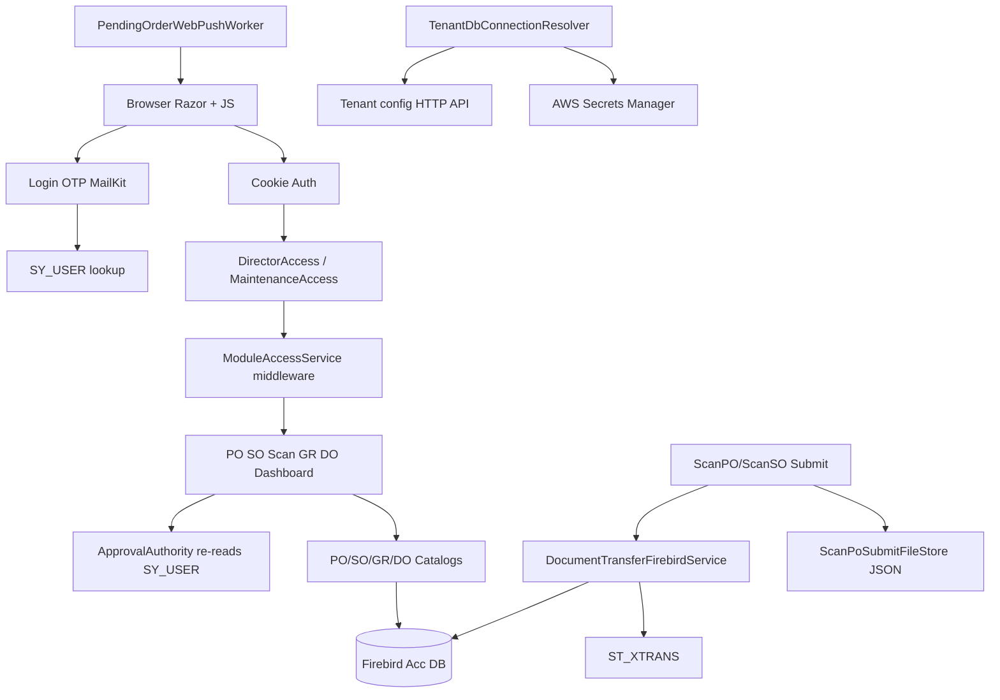

# ApprovalPO — Full Code Quality, Security & Architecture Audit

**Repository:** https://github.com/JJasXS/ApprovalPO  
**Audit date:** 2026-11-11  
**Implementation follow-up:** 2026-11-11 — Stage 1–3 remediations applied in-repo (guide-capture hardening, production safety asserts, IP throttle defaults, login CSRF, CSP, module fail-closed, PO/SO approval concurrency + SO multi-level parity, line-transferable authz, approval audit file store, configurable bands, batched SO delivery lines, cert2.der removed). `System.Security.Cryptography.Pkcs` advisories remain on NuGet (no fixed package yet).  
**Original method:** Static inspection of source, config, smoke tests, `dotnet list package --vulnerable`, and Notion knowledge-base search.

---

## 1. Executive Summary

ApprovalPO is a **tenant-scoped ASP.NET Core 8 Razor Pages** layer over **SQL Accounting Firebird**. It does **not** create purchase orders; staff **approve/reject** Acc documents, then **scan** approved PO/SO into GR/DO via Firebird transfers and `ST_XTRANS`.

**Overall condition:** Production-capable for a controlled LAN/tenant deployment, with a **real authentication/authorization stack**, parameterized Firebird access in the inspected paths, CSRF on main mutation handlers, and multi-level PO approval. The highest risks are **conditional auth bypass tooling** (`APPROVAL_GUIDE_CAPTURE`), **misconfiguration levers** that can leak OTP or disable IP throttle / SY_USER checks, **SO vs PO approval asymmetry**, **concurrent approval race**, **weak CSP**, and **thin automated test coverage**.

**Production readiness (evidence-based):** Suitable for continued production use **if** guide-capture is off, OTP exposure flags are off, IP OTP throttle is enabled in production config, and TLS/host hardening matches the SECURITY_HARDENING checklist. Not “enterprise-hardened” without Stage 1–2 fixes below.

---

## 2. Repository Overview

| Area | Evidence |
|------|----------|
| Backend | ASP.NET Core **net8.0** Razor Pages + Controllers (`ApprovalPO.csproj`) |
| Frontend | Server-rendered Razor + vanilla JS under `wwwroot/js/` (no React/Vue); CSS in `wwwroot/css/` |
| DB | Firebird via `FirebirdSql.Data.FirebirdClient` 10.3.4 |
| Auth | Email **OTP** (MailKit) + cookie auth; users from Acc `SY_USER` |
| Secrets | AWS Secrets Manager (`AWSSDK.SecretsManager`), DotNetEnv, tenant HTTP bootstrap |
| Other | WebPush (optional), OpenAI OCR (optional), Windows Service host |
| Tests | Smoke console projects under `tests/` — **not** a unit/integration suite |
| Deploy | Windows Service / Kestrel; docs in `docs/`, `SECURITY_HARDENING.md`, `deploy/` |

**Tracked concern:** `cert2.der` is **tracked in git** (commit `da50a3f`, ~982 bytes). `.pfx` / `.env` are gitignored and not tracked.

---

## 3. Actual System Architecture

### Real workflow (from code — not assumed)

1. **Login** — `Pages/Login.cshtml.cs`: email → SY_USER lookup → OTP send/verify → cookie claims (`SyUserApprovalMapper`).  
2. **PO creation** — **Outside this app** (SQL Acc). ApprovalPO lists `PH_PO` / `PH_PODTL`.  
3. **Submit for approval** — Acc document appears with pending `UDF_POSTATUS`.  
4. **Approve (PO)** — `PurchaseOrders.OnPostSetTransferableAsync` → `AuthorizePartialApproveAsync` → `TryRecordApprovalAsync` writes level slots + status. Higher level can fill lower empty slots (by design).  
5. **Reject / Cancel / Reset Pending** — amount-gated via `AuthorizeListStatusChangeAsync`.  
6. **SO approve** — `SalesOrders.OnPostSetTransferableAsync` uses **list** amount gate only (no multi-level slots path in that handler).  
7. **Scan → GR/DO** — Scan detail submit → Firebird transfer + `ST_XTRANS`; local JSON audit in `ScanPoSubmitFileStore`.  
8. **Notifications** — optional Web Push worker; OTP email for login only (not a full PO approval email pipeline in inspected code).

### Missing / unclear components

- No first-class **immutable approval audit table** for PO status changes (slots on `PH_PO` only).  
- No in-app **PO create/edit** UI.  
- Module middleware **fail-open** when tenant module config is null.  
- Development Knowledge Base: **no ApprovalPO-specific incident history** found in Notion search (only unrelated guides). A Notion “Project .env” page exists with operational secrets — **organizational secret-hygiene risk outside the repo**; values are not reproduced here.

---

## 4. Overall Security Assessment

**Strengths (confirmed):** Cookie HttpOnly; folder authorize + Director/Admin policies; CSRF on PO/SO/scan posts; parameterized docKey updates; OCR path traversal guards; security headers middleware; OTP lockouts in `OtpSessionStore` (per-email); amount authority re-checked against live SY_USER.

**Weaknesses (confirmed or highly probable):** Guide-capture anonymous login when env enabled; default IP throttle **disabled** (`LoginMax*PerIpPerMinute: 0`); CSP allows `'unsafe-inline'`/`'unsafe-eval'`; Login ignores antiforgery; SO single-step approve vs PO multi-level; concurrent approval without row versioning; transitive NuGet advisory on `System.Security.Cryptography.Pkcs`.

---

## 5. Coding Standards Assessment

- Clear `Services/`, `Pages/`, `Authorization/`, `Helpers/` layout; many thin page handlers.  
- Some large JS files (`wwwroot/js/po-list.js`, `scan-po-detail.js`) with mixed UI + workflow.  
- Hardcoded approval bands in `ApprovalLevelWorkflow` (10k / 100k / 1M) — business policy in code.  
- Duplicate patterns between PO and SO pages (line transferable, notify snapshot).  
- Smoke tests only; no CI workflow file found in repo root for GitHub Actions.  
- Workspace coding-standards rules (nesting / Helpers) are partially followed; historical files remain dense.

---

## 6–11. Findings by Theme (summary)

See **§13 Full Findings Register** for file/line evidence. Themes:

- AuthN/AuthZ: guide capture, OTP exposure flags, IP throttle defaults, module fail-open.  
- API: login CSRF ignore; line transferable without amount authority.  
- DB: parameterized queries; approval UPDATE race; configurable SQL overrides.  
- Workflow: L3 skip-fill-by-design; SO ≠ PO; no PO create.  
- Frontend: CSP weak; mobile scan UX matured; duplicate-click partially handled in JS.  
- Performance: SO delivery list N+1 progress loads.  
- Testing: authority/roles smokes exist; no CSRF/authz integration suite.

---

## 12. Testing Coverage and Gaps

| Present | Missing |
|---------|---------|
| `ApprovalAuthoritySmoke` | AuthN OTP integration |
| `RolesParserSmoke` | CSRF / antiforgery |
| `ScanPoMatchSmoke` | Concurrent approval race |
| `SubscriptionBannerSmoke` | SO multi-level (N/A today) |
| `ApprovalDbSmoke` (optional DB) | Notification failure isolation |
| | Financial re-approval after Acc edit |

`dotnet list package --vulnerable` (2026-11-11): transitive **System.Security.Cryptography.Pkcs 8.0.1** — High/Moderate advisories (GHSA-846f-f764-76mx, GHSA-2fmv-rv2c-59x7). Confirm whether a direct bump is reachable without breaking MailKit/WebPush.

---

## 13. Full Findings Register

### SEC-001 — Guide capture anonymous cookie login (Admin + Director)
| Field | Value |
|-------|--------|
| Severity | **Critical** (when enabled) / **Medium** (when disabled) |
| Category | Security |
| File | `Controllers/GuideCaptureController.cs` |
| Line | 39–40, 42–109 |
| Problem | `[AllowAnonymous]` `POST /api/guide_capture/login` signs in a user and **forces Admin + Director** roles when `APPROVAL_GUIDE_CAPTURE=1`. |
| Evidence | `IsEnabled()` checks env; then `SignInAsync` after adding Admin/Director claims. |
| Impact | Full approval/scan privilege without OTP if flag left on in production. |
| Recommendation | Remove from production builds, or require mutual TLS / shared secret + deny by default; never auto-elevate. |
| Verification | With flag unset → 404; with flag set → must still require strong gate. |
| Confidence | **Confirmed** (code) |

### SEC-002 — OTP can be returned in HTTP JSON when email fails
| Field | Value |
|-------|--------|
| Severity | **High** (if prod misconfigured) |
| Category | Security |
| File | `Pages/Login.cshtml.cs` |
| Line | 170–175, 181–191 |
| Problem | `ExposeOtpWhenEmailFails` / `APPROVALPO_ALLOW_OTP_WITHOUT_EMAIL` puts OTP in response body. |
| Evidence | `payload["devOtp"] = otpPlain` in non-Development when bypass on. |
| Impact | Anyone who can trigger send OTP for a known email may obtain the code if SMTP fails and bypass is on. |
| Recommendation | Keep false in production; alert on SMTP failure; never echo OTP. |
| Verification | Prod config audit + send-OTP response without `devOtp`. |
| Confidence | **Confirmed** |

### SEC-003 — Per-IP login throttle disabled by default
| Field | Value |
|-------|--------|
| Severity | **High** |
| Category | Security |
| File | `appsettings.json`, `Services/Auth/LoginIpThrottle.cs` |
| Line | appsettings 35–36; LoginIpThrottle 32–34, 56–58 |
| Problem | `LoginMaxSendOtpPerIpPerMinute` / `Verify` default **0** → throttle no-ops. |
| Evidence | `if (max <= 0) return true;` |
| Impact | Brute-force / OTP spray limited only by per-email store, not IP. |
| Recommendation | Set production values (e.g. 3/5) as in SECURITY_HARDENING.md. |
| Verification | Exceed limit → throttle JSON. |
| Confidence | **Confirmed** |

### SEC-004 — Login ignores antiforgery
| Field | Value |
|-------|--------|
| Severity | **Medium** |
| Category | Security |
| File | `Pages/Login.cshtml.cs` |
| Line | 18 |
| Problem | `[IgnoreAntiforgeryToken]` on login handlers. |
| Evidence | Attribute on page model. |
| Impact | Cross-site OTP send/verify attempts (mitigated by OTP secrecy; still CSRF surface). |
| Recommendation | Enable antiforgery on login POSTs like other pages. |
| Verification | POST without token rejected. |
| Confidence | **Confirmed** |

### SEC-005 — Content-Security-Policy allows unsafe script
| Field | Value |
|-------|--------|
| Severity | **Medium** |
| Category | Security |
| File | `Hosting/SecurityHeadersExtensions.cs` |
| Line | 35–36 |
| Problem | `script-src 'self' 'unsafe-inline' 'unsafe-eval'`. |
| Evidence | CSP string. |
| Impact | XSS becomes easier to weaponize if any injection point appears. |
| Recommendation | Tighten to nonces/hashes; remove unsafe-eval. |
| Verification | Browser CSP report / header check. |
| Confidence | **Confirmed** |

### SEC-006 — Module access fail-open
| Field | Value |
|-------|--------|
| Severity | **Medium** |
| Category | Security |
| File | `Services/Auth/ModuleAccessService.cs` |
| Line | 32–42 |
| Problem | Empty tenant or null modules → allow path. |
| Evidence | `return true` when tenant empty or modules null. |
| Impact | Mis-bootstrap may expose modules that should be hidden (still behind Director policy). |
| Recommendation | Fail closed for module-mapped paths when tenant expected. |
| Verification | Null module config → 403/redirect away. |
| Confidence | **Confirmed** |

### SEC-007 — Line transferable change without amount authority
| Field | Value |
|-------|--------|
| Severity | **Medium** |
| Category | Security / Workflow |
| File | `Pages/PurchaseOrders.cshtml.cs`, `Pages/SalesOrders.cshtml.cs` |
| Line | PO 184–195; SO 126–137 |
| Problem | Any DirectorAccess user can POST line transferable; no `IApprovalAuthority` call. |
| Evidence | Handler goes straight to catalog update (pending header still required in SQL). |
| Impact | Approvers outside amount band can alter line transfer flags on pending docs. |
| Recommendation | Reuse amount gate or restrict to elevated/admin. |
| Verification | Low-band user POST → 403. |
| Confidence | **Confirmed** |

### SEC-008 — Transitive vulnerable package
| Field | Value |
|-------|--------|
| Severity | **Medium** (advisory; exploitability in this app **Needs verification**) |
| Category | Security |
| File | Package graph (`System.Security.Cryptography.Pkcs` 8.0.1) |
| Line | N/A |
| Problem | `dotnet list package --vulnerable` reports High/Moderate GHSA. |
| Evidence | CLI output 2026-11-11. |
| Impact | Depends on whether vulnerable code paths are exercised. |
| Recommendation | Upgrade transitive dependency when compatible. |
| Verification | Re-run vulnerable list after bump. |
| Confidence | **Confirmed** advisory; exploit **Needs verification** |

### SEC-009 — Tracked DER certificate in repo
| Field | Value |
|-------|--------|
| Severity | **Low** |
| Category | Security |
| File | `cert2.der` |
| Line | N/A |
| Problem | Certificate material committed. |
| Evidence | `git ls-files` includes `cert2.der`. |
| Impact | Usually public cert only; still clutter / accidental private-key risk if paired elsewhere. |
| Recommendation | Remove from git history if unused; keep only under ignored `tls/`. |
| Verification | `git ls-files` clean of certs. |
| Confidence | **Confirmed** |

### SEC-010 — SkipSyUserEmailCheck configuration hazard
| Field | Value |
|-------|--------|
| Severity | **High** (if enabled) |
| Category | Security |
| File | `Options/ApprovalOptions.cs`, `Services/Auth/SyUserLoginValidator.cs` |
| Line | Options ~80; validator ~107 |
| Problem | Flag can skip SY_USER email enforcement. |
| Evidence | Option + early skip branch. |
| Impact | Login may accept emails not in Acc user table (depending on skip semantics). |
| Recommendation | Force false in Production; assert at startup. |
| Verification | Startup fails if true in Production. |
| Confidence | **Probable** (confirm skip path fully) |

### WF-001 — Concurrent PO approval race
| Field | Value |
|-------|--------|
| Severity | **High** |
| Category | Workflow / Database |
| File | `Services/Orders/PurchaseOrderCatalogService.cs` |
| Line | 178–237 |
| Problem | Read slots → compute → UPDATE without optimistic concurrency / transaction isolation. |
| Evidence | `TryRecordApprovalAsync` sequential read then update by DOCKEY only. |
| Impact | Two approvers can overwrite slots or double-complete inconsistently. |
| Recommendation | Transaction + `WHERE` old slot values / row version; unique constraint strategy. |
| Verification | Parallel approve smoke. |
| Confidence | **Confirmed** (logic) |

### WF-002 — SO approval lacks multi-level workflow used by PO
| Field | Value |
|-------|--------|
| Severity | **High** (if business expects parity) / **Low** (if intentional) |
| Category | Workflow |
| File | `Pages/SalesOrders.cshtml.cs` |
| Line | 115–119 |
| Problem | Uses `AuthorizeListStatusChangeAsync` then single status set — not `AuthorizePartialApproveAsync`. |
| Evidence | Handler code vs PO partial path. |
| Impact | One in-band user can fully approve SO. |
| Recommendation | Confirm business rule; if parity needed, reuse PO slot workflow. |
| Verification | Policy doc + SO approve test. |
| Confidence | **Confirmed** asymmetry; business intent **Needs verification** |

### WF-003 — Higher-level approver fills lower slots (skip sequence)
| Field | Value |
|-------|--------|
| Severity | **Low** (documented design) |
| Category | Workflow |
| File | `Services/Auth/ApprovalLevelWorkflow.cs` |
| Line | 5–7, 42–69 |
| Problem | Not sequential; L3 can fill L1–L3 empty slots. |
| Evidence | Comments + `SlotsToFill`. |
| Impact | “Skip levels” is allowed by design for higher levels. |
| Recommendation | Document for auditors; change only if policy requires strict sequence. |
| Verification | Policy sign-off. |
| Confidence | **Confirmed** |

### WF-004 — No immutable PO approval audit log
| Field | Value |
|-------|--------|
| Severity | **Medium** |
| Category | Workflow |
| File | `PurchaseOrderCatalogService.TryRecordApprovalAsync` |
| Line | 178+ |
| Problem | Only mutable slot columns on `PH_PO`; scan has JSON audit, PO approve does not append append-only events. |
| Evidence | No audit insert alongside status update. |
| Impact | Harder forensics; slot clears on reject can erase history. |
| Recommendation | Append-only approval event table or Acc UDF log. |
| Verification | Approve → reject → prior actors still queryable. |
| Confidence | **Confirmed** |

### WF-005 — App does not create/validate PO financials at source
| Field | Value |
|-------|--------|
| Severity | N/A (scope) |
| Category | Workflow |
| File | README / catalogs |
| Line | N/A |
| Problem | Creation/totals owned by SQL Acc; ApprovalPO trusts header amount for gates. |
| Evidence | No PH_PO insert in app services (except test seed). |
| Impact | Acc-side edits after partial approval need policy (reapproval) — not enforced here. |
| Recommendation | Business rule: lock Acc edits after first sign, or re-open pending on amount change. |
| Verification | Acc change after L1 → expected status. |
| Confidence | **Confirmed** scope boundary |

### CODE-001 — Hardcoded approval amount bands
| Field | Value |
|-------|--------|
| Severity | **Medium** |
| Category | Code |
| File | `Services/Auth/ApprovalLevelWorkflow.cs` |
| Line | 11–13 |
| Problem | 10k/100k/1M constants. |
| Evidence | `BandLevel*Max`. |
| Impact | Tenant policy changes require redeploy. |
| Recommendation | Config/options with validation. |
| Verification | Config override smoke. |
| Confidence | **Confirmed** |

### CODE-002 — Large client JS modules
| Field | Value |
|-------|--------|
| Severity | **Low** |
| Category | Code |
| File | `wwwroot/js/po-list.js`, `wwwroot/js/scan-po-detail.js` |
| Line | N/A (file-level) |
| Problem | High responsibility concentration. |
| Evidence | Size / mixed concerns from inspection. |
| Impact | Regression risk on UX changes. |
| Recommendation | Split modules gradually (list / review / scan). |
| Verification | Existing smokes + manual scan. |
| Confidence | **Confirmed** |

### PERF-001 — SO delivery progress N+1
| Field | Value |
|-------|--------|
| Severity | **Medium** |
| Category | Performance |
| File | `Services/Orders/SalesOrderDeliveryQueryService.cs` |
| Line | 48–51 |
| Problem | Per approved SO, `GetLinesWithDeliveredAsync`. |
| Evidence | Loop in `ListApprovedWithProgressAsync`. |
| Impact | Slow ScanSO / dashboard delivery todo counts at scale. |
| Recommendation | Batch XTRANS + lines query. |
| Verification | Timing with many approved SOs. |
| Confidence | **Confirmed** (code pattern; not load-tested here) |

### PERF-002 — Dashboard goods todo uses submit store + full approved list
| Field | Value |
|-------|--------|
| Severity | **Low** |
| Category | Performance |
| File | `Services/DashboardOverviewService.cs` |
| Line | `CountGoodsTodoAsync` |
| Problem | Loads all approved POs + submit summaries. |
| Evidence | Recent dashboard badge implementation. |
| Impact | Dashboard latency grows with PO volume. |
| Recommendation | SQL-side outstanding if Acc supports it. |
| Verification | Profile OnGet Dashboard. |
| Confidence | **Confirmed** |

### UI-001 — Module deny redirects to Dashboard
| Field | Value |
|-------|--------|
| Severity | **Low** |
| Category | UI |
| File | `Program.cs` |
| Line | 325–336 |
| Problem | Disallowed module → redirect `/Dashboard` (not 403 page). |
| Evidence | Middleware. |
| Impact | Confusing UX; API-ish handlers may get HTML redirect. |
| Recommendation | 403 NoAccess for page GETs; 403 JSON for handlers. |
| Verification | Disabled module path. |
| Confidence | **Confirmed** |

### TEST-001 — No automated CSRF / concurrent approval / OTP tests
| Field | Value |
|-------|--------|
| Severity | **Medium** |
| Category | Testing |
| File | `tests/` |
| Line | N/A |
| Problem | Smokes only. |
| Evidence | Project list; no xUnit/NUnit suite. |
| Impact | Regressions in authz/workflow likely. |
| Recommendation | Add focused integration tests for approve race + CSRF. |
| Verification | CI green. |
| Confidence | **Confirmed** |

### DB-001 — Configurable raw list/lines SQL
| Field | Value |
|-------|--------|
| Severity | **Medium** (ops) |
| Category | Database |
| File | `PurchaseOrderCatalogService.cs` / `ApprovalOptions` |
| Line | ~36–38, ~311–314 |
| Problem | `PurchaseOrdersSql` / lines SQL from config executed as app SQL. |
| Evidence | Override path. |
| Impact | Misconfiguration → broken lists or unsafe SQL if config compromised. |
| Recommendation | Restrict to known templates; least-privilege DB user (not SYSDBA if possible). |
| Verification | Config review; DB user audit. |
| Confidence | **Confirmed** |

### DB-002 — Default Firebird user name SYSDBA in appsettings
| Field | Value |
|-------|--------|
| Severity | **Medium** |
| Category | Database |
| File | `appsettings.json` |
| Line | 19 |
| Problem | `FirebirdUser": "SYSDBA"` placeholder. |
| Evidence | Config. |
| Impact | Encourages over-privileged runtime identity. |
| Recommendation | Dedicated least-privilege Acc user in production. |
| Verification | App works without SYSDBA. |
| Confidence | **Confirmed** config; prod identity **Needs verification** |

---

## 14. Top 10 Highest-Priority Improvements

1. Ensure `APPROVAL_GUIDE_CAPTURE` never on in production (SEC-001).  
2. Lock OTP exposure / SkipSyUser flags off at startup in Production (SEC-002, SEC-010).  
3. Enable IP OTP throttle in production config (SEC-003).  
4. Add optimistic concurrency to PO approval updates (WF-001).  
5. Decide and document SO vs PO approval parity (WF-002).  
6. Append-only approval audit (WF-004).  
7. Gate line-transferable with authority (SEC-007).  
8. Tighten CSP (SEC-005).  
9. Address Pkcs package advisories (SEC-008).  
10. Batch SO delivery progress queries (PERF-001).

---

## 15. Improvement Roadmap

### Stage 1 — Immediate Security Fixes (Small–Medium)
| Item | Effort | Modules |
|------|--------|---------|
| Disable/remove guide capture elevation | S | Controllers |
| Startup asserts for dangerous Approval flags | S | Program / Options |
| Production IP throttle values | S | Config |
| CSP tighten (incremental) | M | Hosting + JS |

### Stage 2 — Business Logic & Data Integrity (Medium–Large)
| Item | Effort | Modules |
|------|--------|---------|
| Approval row concurrency | M | PurchaseOrderCatalogService |
| SO workflow parity (if required) | L | SalesOrders + catalog |
| Approval event audit | M | Services / Firebird UDF |
| Line transferable authz | S | PO/SO pages |

### Stage 3 — Reliability & Performance (Medium)
| Item | Effort | Modules |
|------|--------|---------|
| Batch delivery progress | M | SalesOrderDeliveryQueryService |
| Vulnerable package bump | S | csproj |
| Integration tests approve/CSRF | M | tests/ |

### Stage 4 — Coding Standards (Ongoing)
| Item | Effort | Modules |
|------|--------|---------|
| Configurable approval bands | S | Options + Workflow |
| Split large JS | L | wwwroot/js |

### Stage 5 — UX
| Item | Effort | Modules |
|------|--------|---------|
| Proper 403 for module deny | S | Program middleware |
| Consistent SO/PO status copy | S | Pages / JS |

**Order:** Stage 1 config/flags → WF-001 concurrency → authz gaps → perf → refactors. Avoid combining SO workflow rewrite with concurrency change in one deploy.

---

## 16. Regression Testing Checklist

- [ ] Login OTP send/verify (happy + lockout)  
- [ ] Director vs amount-limited approve/reject PO  
- [ ] Multi-level PO Waiting → Final  
- [ ] Parallel double-approve same PO  
- [ ] SO approve/reject  
- [ ] Line transferable only while pending  
- [ ] ScanPO → GR + ST_XTRANS  
- [ ] ScanSO → DO + SQTY Left  
- [ ] Dashboard badges  
- [ ] Module flag hide/show  
- [ ] CSRF token required on approve POST  
- [ ] Guide capture 404 when disabled  

---

## 17. Deployment and Rollback Considerations

- Prefer config-only Stage 1 fixes (throttle, flags) — instant rollback via config.  
- Concurrency SQL changes need Firebird backup + feature flag if possible.  
- Do not enable `APPROVAL_GUIDE_CAPTURE` on shared hosts.  
- Keep TLS PFX outside git (`tls/` ignored).  
- Rollback: redeploy previous Windows Service package; Acc slot columns are additive — clearing them is a data decision.

---

## 18. Limitations and Unverified Areas

- No production penetration test or authenticated browser exploit run.  
- Firebird grants / indexes on live Acc DB **Not Assessed**.  
- Whether production currently sets IP throttle / guide flag **Needs verification** on the host.  
- Full OpenAI/OCR abuse surface lightly reviewed.  
- Android Chainway companion out of deep scope.  
- Notion KB: no ApprovalPO remediation history found; do not treat LabVIEW guides as prior art for this app.

---

## Scores (/10)

| Category | Score | Criteria / evidence |
|----------|------:|---------------------|
| Security | **6.5** | Solid cookie+OTP+policies; critical only if guide capture on; CSP/throttle/config hazards |
| Code Quality | **7.0** | Clear services; some large JS/handlers |
| Maintainability | **6.5** | PO/SO duplication; hardcoded bands |
| Architecture | **7.5** | Sensible Acc overlay; clear module boundaries |
| Database Integrity | **6.0** | Parameterized; approval race; SYSDBA default |
| Approval Workflow Reliability | **6.5** | PO multi-level solid; SO asymmetry; concurrency gap |
| Performance | **6.0** | N+1 delivery list; OK for small tenants |
| Testing | **4.0** | Smokes only |
| **Overall Production Readiness** | **6.5** | Operable with Stage 1 config discipline; not fully hardened |

---

*End of audit report. No application source was modified for this audit. Wait for explicit approval before implementing fixes.*
