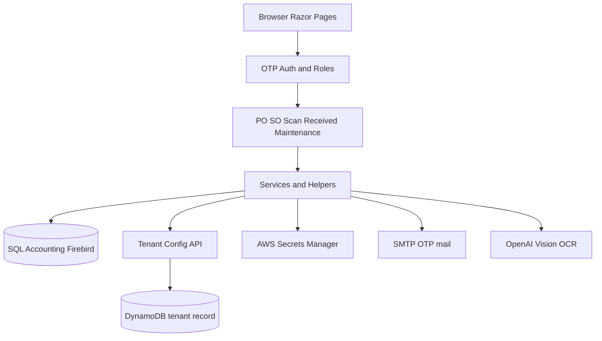

# ApprovalPO

Purchase-order and goods-received approval workflow for SQL Accounting, with barcode scanning and optional OpenAI document OCR.

## Overview

ApprovalPO is an ASP.NET Core 8 Razor Pages application that sits on top of a SQL Accounting (Firebird) company database. Staff sign in with email OTP, then approve or reject purchase and sales orders, scan purchase orders into goods received, review received goods, and run maintenance barcode scans.

It is intended for operators and managers who already run SQL Accounting and need a browser-based approval and scanning layer without working inside the ERP desktop client.

It was built so tenant Firebird connection details can be loaded at runtime from a tenant-config API, with SMTP and OpenAI credentials resolved from AWS Secrets Manager rather than hardcoded files.

## Key Features

- Email OTP sign-in against SQL Accounting `SY_USER` records
- Role-based access (Admin / Maintenance from `SY_USER.UDF_APPROLE`, with PO/SO approve limited to `UDF_APPFROM`–`UDF_APPTO`)
- Purchase order review, approve, reject, and bulk approve
- Sales order approval with the same pending/approved/cancelled/rejected tabs
- Scan PO into goods received (camera barcode flow)
- Received-goods review
- Maintenance barcode scanner
- Optional OpenAI vision OCR on the Scan PO detail page (`Services/Ocr/`)
- Optional Web Push notifications (`WebPush` package; disabled by default)
- Tenant bootstrap from a configurable HTTP API plus AWS Secrets Manager
- Runs as a Windows Service (`Microsoft.Extensions.Hosting.WindowsServices`)

## Architecture



Company accounting data stays in the Firebird `.FDB` file. ApprovalPO does not replace SQL Accounting; it reads and writes through the application services that wrap Firebird and, for some transfers, helper scripts under `scripts/`.

## Tech Stack

- C# / ASP.NET Core 8 Razor Pages
- Firebird (`FirebirdSql.Data.FirebirdClient`)
- MailKit (OTP email)
- AWS SDK Secrets Manager
- OpenAI HTTP API (optional OCR)
- WebPush (optional)
- DotNetEnv for local `.env`

## Setup

1. Copy [`.env.example`](.env.example) to `.env` in this folder.
2. Set `TENANT_CODE`, `TENANT_BOOTSTRAP_API_URL` (or `TenantBootstrap__AwsApiBaseUrl`), and `FIREBIRD_PASSWORD`.
3. Place a TLS PFX next to the process (default `tls/site.pfx`) or set `Approval:TlsPfxPath`. Do not commit `.pfx` files.
4. Configure AWS credentials that can read the tenant SMTP / OpenAI secret refs, or leave those features unused.
5. Run:

```powershell
dotnet run --project ApprovalPO.csproj
```

Default HTTP/HTTPS ports are `Approval:PublicHttpPort` (2095) and `Approval:PublicHttpsPort` (2096).

User-facing screenshots live in [`docs/USER_GUIDE.md`](docs/USER_GUIDE.md). Architecture notes: [`docs/architecture.md`](docs/architecture.md).

## Testing

Smoke projects (not a full unit-test suite):

```powershell
dotnet run --project tests/RolesParserSmoke/RolesParserSmoke.csproj
dotnet run --project tests/ScanPoMatchSmoke/ScanPoMatchSmoke.csproj
```

## Security

- Secrets belong in `.env` or AWS Secrets Manager, never in `appsettings.json`.
- `.pfx` certificates must stay untracked (see `.gitignore`).
- Treat any previously committed certificate or API URL in git history as compromised and rotate it.

## License

[ADD INFORMATION]
