# ProAcc Approvals User Guide

Approve purchase and sales orders, scan POs into goods received, and run maintenance barcode scans.

---

## Sign in

1. Open the Approval PO login page.
2. Enter your email address.
3. Click Send OTP.
4. Enter the 6-digit OTP from your email.
5. Click Verify OTP.
6. You land on the home Dashboard.

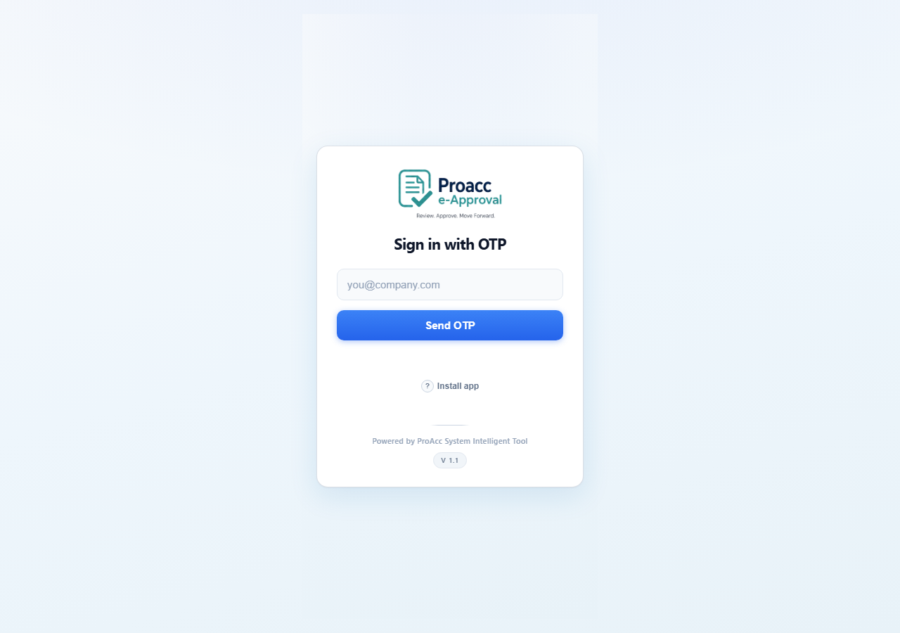

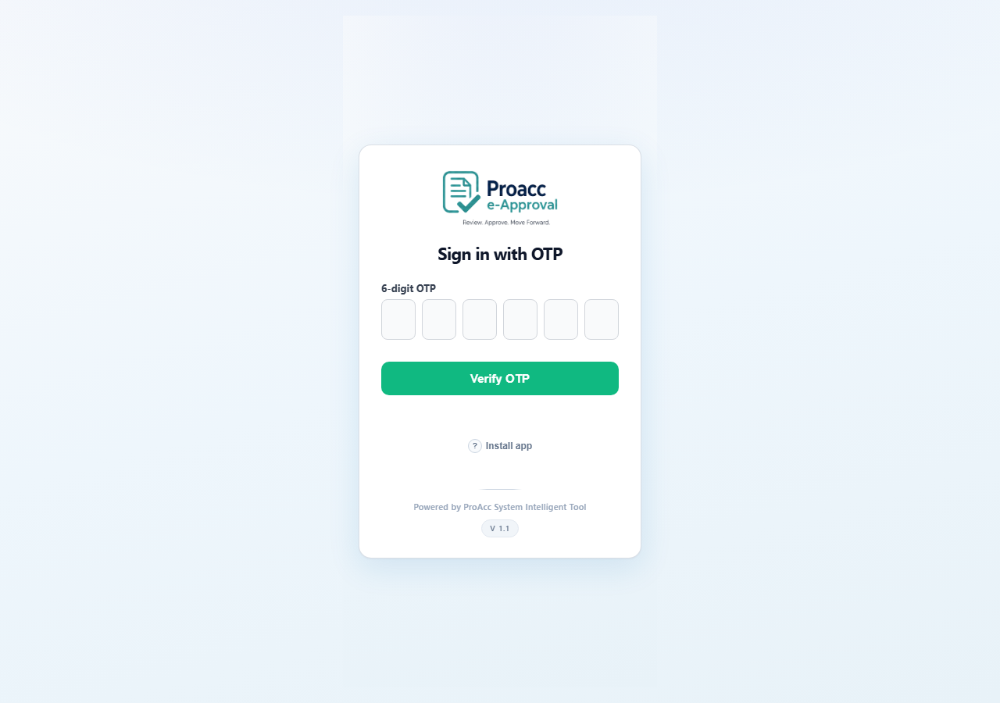

---

## Dashboard

1. After sign-in you see What would you like to do?
2. Your role chip (Admin / Maintenance, plus approval level when set) and name appear in the header.
3. Open a module card: Purchase Approval, Sales Approval, Scanning PO, Received goods, or Maintenance Scanner.
4. Use Sign out in the header when finished.

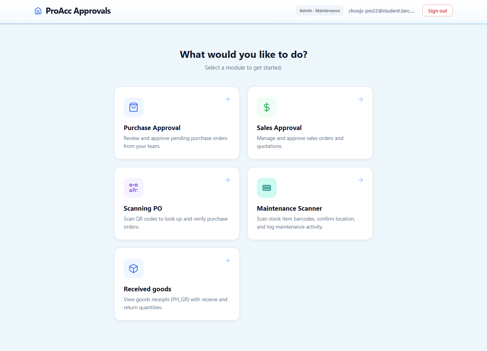

---

## Purchase Approval

1. From the Dashboard, open Purchase Approval.
2. Use tabs: Pending, Approved, Cancelled, or Rejected.
3. Click Review on an order to open the detail sheet.
4. Approve or Reject the order (or use Select all + Bulk approve for several pending orders). Approve, reject, and bulk approve only work for documents whose amount is inside your SQL Accounting approval range (`UDF_APPFROM` to `UDF_APPTO`, inclusive). Orders outside that range show a message and stay unchanged.
5. Use Sales Approval in the header to switch modules, or Menu for Back to home / Sign out.

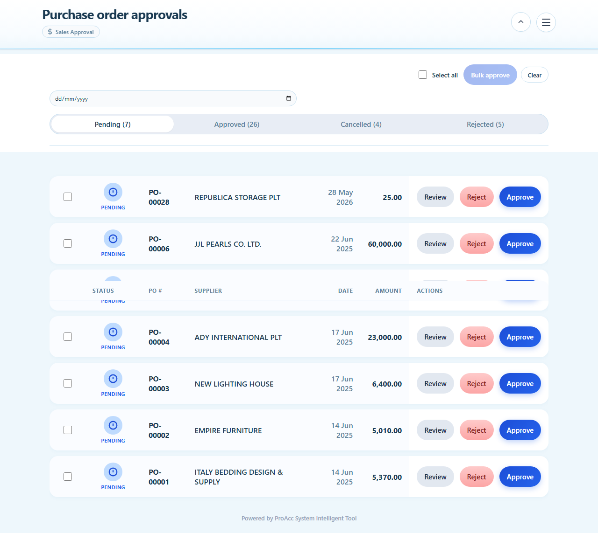

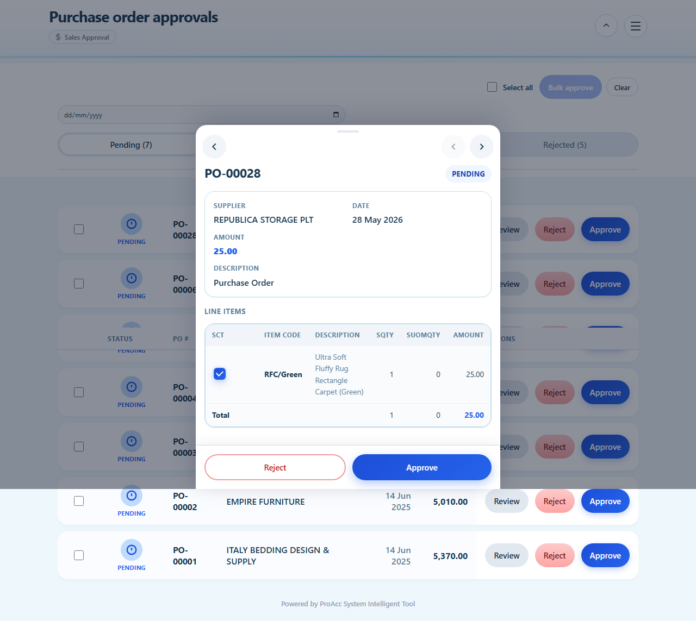

---

## Sales Approval

1. From the Dashboard, open Sales Approval (or switch from Purchase Approval).
2. Filter with Pending / Approved / Cancelled / Rejected tabs.
3. Click Review on an order to see lines and details.
4. Approve or Reject as needed. The same amount-range limit as Purchase Approval applies.

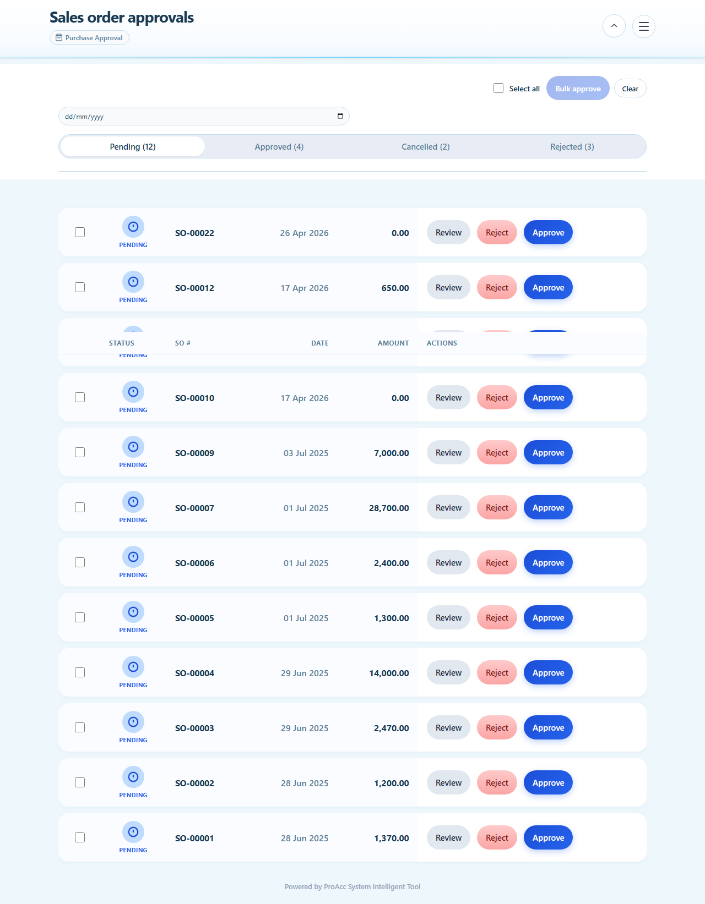

---

## Scanning PO

1. From the Dashboard, open Scanning PO.
2. Use tabs To scan or Submitted.
3. Search by PO # if needed, then open a purchase order.
4. On the detail page, use the Scan tab to scan or enter item codes.
5. Set received quantities on the Received qty tab.
6. Click Submit when ready (or Reset scan / Reopen for scanning if shown).

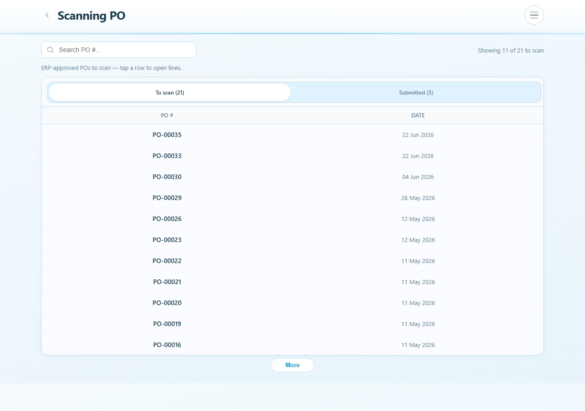

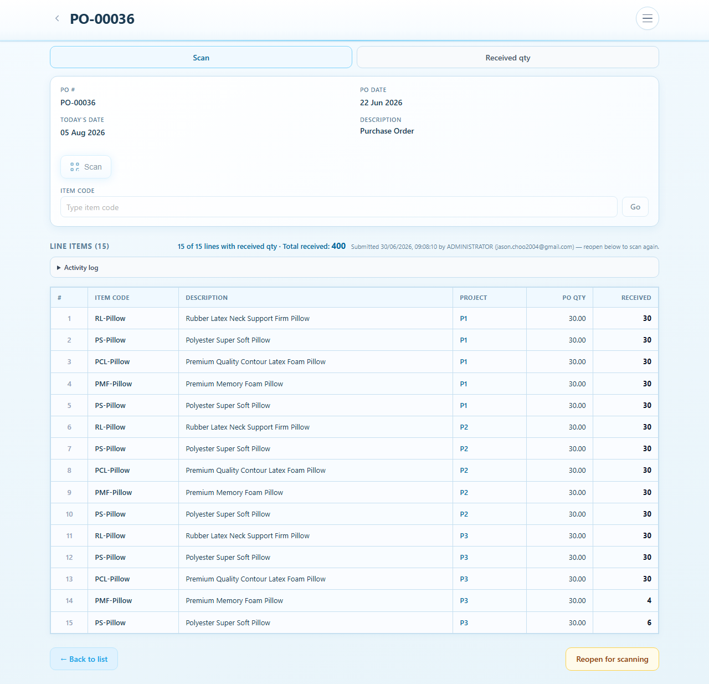

---

## Received goods

1. From the Dashboard, open Received goods.
2. Browse goods receipt records created from submitted scans.
3. Open a receipt to review line receive and return quantities.
4. Use Scan PO if you need to return to scanning.

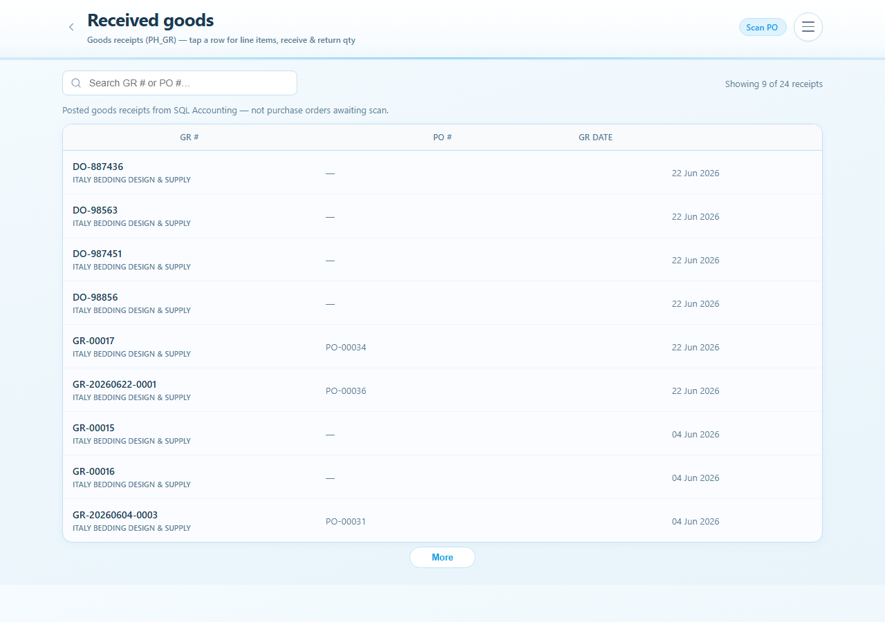

---

## Maintenance Scanner

1. From the Dashboard, open Maintenance Scanner.
2. If asked for Your name for scans, enter a display name and continue.
3. Click Start Scanner and point the camera at the barcode (or enter the code manually if available).
4. Review Scanned Location, then choose Yes or No.
5. If No, select the correct location.
6. Enter Remarks if needed, then click Update.
7. Use Menu for Back to home or Sign out.

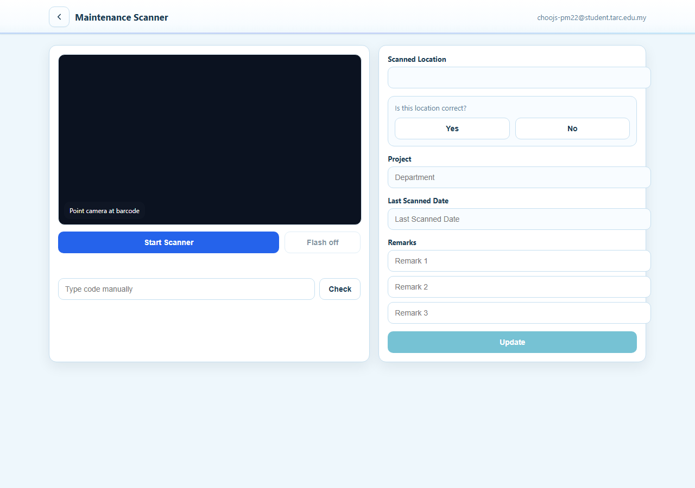

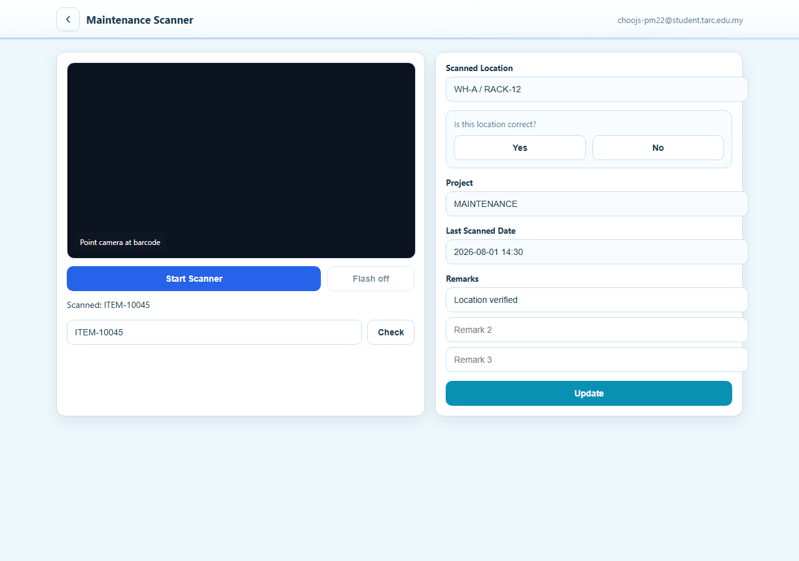

---

## Tips

1. You must be an active SY_USER email to receive an OTP.
2. Module cards depend on your role and tenant settings — missing cards are not available for your account.
3. Phone camera scanning works best over HTTPS on the LAN (see scripts/run-lan.ps1).
4. Optional: use Install app on the login page for a home-screen shortcut.
5. After a deploy, hard-refresh with Ctrl+Shift+R if the page looks old.
