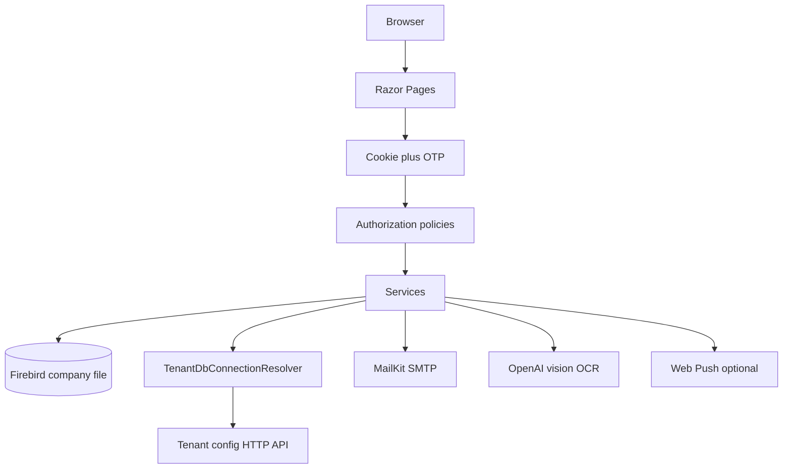

# Architecture

ApprovalPO is an ASP.NET Core 8 Razor Pages app. The browser talks to Razor Page handlers and a few controllers. Business logic lives in `Services/` and `Helpers/`. Authorization policies live in `Authorization/`.

## Main areas

- `Pages/` — Login, Dashboard, PurchaseOrders, SalesOrders, ScanPO, ReceivedGoods, MaintenanceScanner
- `Services/Auth/` — SY_USER login, roles, module access
- `Services/Ocr/` — OpenAI vision on Scan PO detail
- `Services/Email/` — SMTP OTP
- `Helpers/TenantDbConnectionResolver.cs` — tenant HTTP API plus Firebird DSN
- `Authorization/` — role and policy handlers

Company data stays in SQL Accounting Firebird. Tenant host/path come from the tenant-config API at runtime. Secrets (SMTP, OpenAI) are resolved from AWS Secrets Manager when the tenant record includes a secret ref.

Longer narrative: [ENTERPRISE.md](ENTERPRISE.md). User screens: [USER_GUIDE.md](USER_GUIDE.md).
